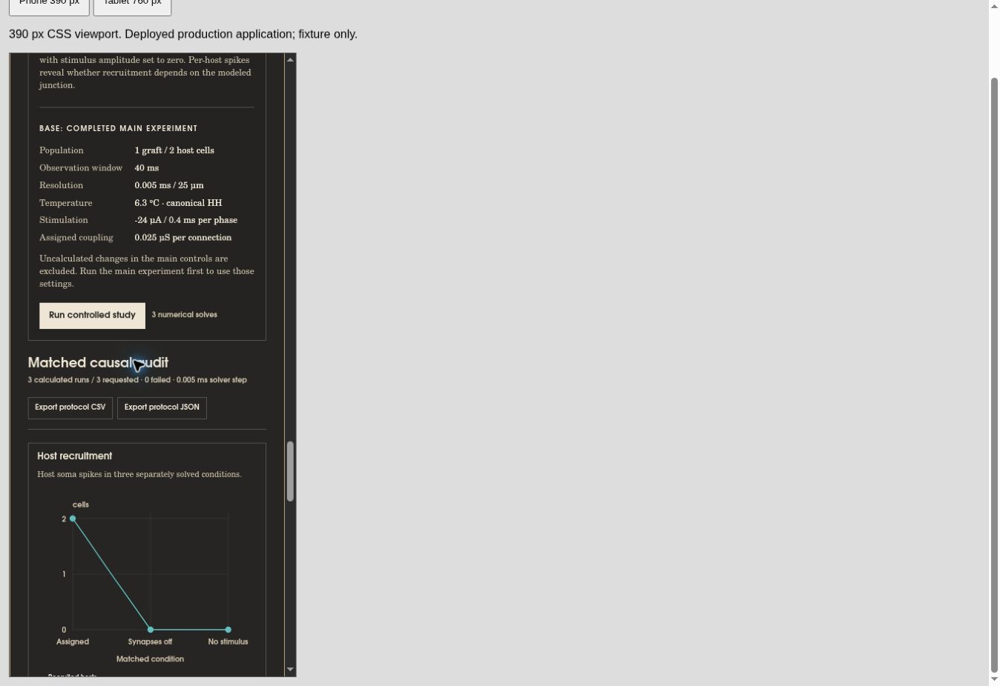
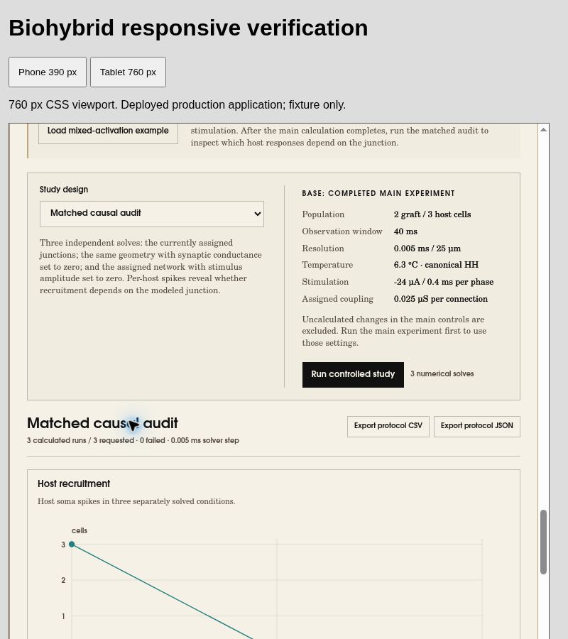

# Biohybrid Stage 2 — production browser verification

Follow-up to the published Stage 2 release, checked on 2026-10-23 in the cloud Chrome browser. Application revision: `40ba6a50425057982eb7c36f0786563d1fe58405` (PR #333). This is a verification/documentation milestone; no application code, model equations, numerical tolerances or saved scientific reports were changed.

## Outcome

The previously unresolved browser-download delivery and responsive-layout checks now have successful observations. GPU rendering remains unverified because this browser cannot create a WebGL context. Neither this follow-up nor the release's numerical agreement establishes biological calibration.

| Check | Observed result | Scope |
|---|---|---|
| Production startup | 574 active compartments; 3/3 hosts; 2.120 ms tip–soma difference; 4.420 ms host–soma difference; R2 9.745 µV p–p | Live HTTPS default run |
| Matched causal audit | Assigned / blocked / no-stimulus recruitment: 3/3, 0/3, 0/3; three completed solves, zero failed | Live HTTPS; not inferred from static text |
| Known-source recording | Graft 5.479451, host 5.927225, combined 9.745330 µV p–p | Independent extrema; these p–p values do not add |
| Six export types | Settings JSON, traces CSV, all-compartments CSV, spikes CSV, protocol JSON and protocol CSV all saved to nonempty files | Actual browser download events and files, not just export-generation tests |
| Settings round-trip | Load downloaded settings after changing to the mixed example, explicitly recalculate, then export again: settings, metrics, spikes, sample count and compartment count match exactly | The display label becomes `Custom experiment`; this is not a byte-identical document round-trip. Elapsed runtime was not compared |
| Phone-width production | 390 px frame; 322 active compartments; one graft/two hosts; audit 2/2, 0/2, 0/2, zero failures | Actual deployed app embedded in a disposable local fixture; desktop Chrome, not a physical phone |
| Tablet-width production | 760 px frame; 574 compartments; two grafts/three hosts; audit 3/3, 0/3, 0/3, zero failures | Actual deployed app; desktop Chrome, not an iPad |
| Page overflow | Phone document client/scroll widths 375/375 px; tablet 745/745 px | Classic 15 px scrollbar occupies part of the 390/760 px frame; no document-level horizontal overflow |
| Responsive themes | Ivory and Graphite layouts inspected at both frame sizes | Screenshots retained below; not a complete WCAG or device certification |
| Narrow result table | Phone measurement region 323 px wide with 892 px scrollable content; focus + ArrowRight moved scrollLeft to 80 px | Intentional table scrolling stays inside the page; keyboard operation exercised |
| Focused automated regression | 22 passed, 0 failed/skipped/cancelled | Export, protocol-export and actual-Worker suites; not a new full-repository test run |

The mixed example was also calculated on production before the import check: 526 compartments, 3/3 hosts, and signed first-crossing differences −0.982 and −0.714 ms. The previous audit was visibly marked as belonging to older settings. Reimporting the original downloaded settings marked controls modified and retained prior measurements until the explicit recalculation completed.

## Download integrity

The [machine-readable record](qa/browser-export-checks.json) retains byte counts, SHA-256 digests and structural results from the actual downloaded files. It contains no private user data. Large raw compartment exports are not committed.

| Export | Bytes | Data rows | Columns |
|---|---:|---:|---:|
| Settings JSON | 7,254 | — | — |
| Protocol JSON | 22,682 | — | — |
| Protocol CSV | 11,631 | 3 | 47 |
| Traces CSV | 257,462 | 801 | 24 |
| All-compartments CSV | 7,078,547 | 801 | 680 |
| Spikes CSV | 685 | 20 | 3 |

Both JSON files parse. Each CSV has consistent column counts. The trace file spans 0–40 ms with 801 rows. For every recorded contact/time, graft plus host source columns reproduce the combined neural column to a maximum residual of approximately 1.000001×10⁻⁹ µV after CSV decimal rounding. The protocol CSV records successful conditions with recruitment [3, 0, 0]. The original Float32 voltage-reconstruction diagnostic is a separate calculation and remains failed; it is not reclassified by this check.

The previous verification session's failed download attempts remain historical observations. No application download fix was necessary in this session, and the cause of the earlier failures has not been established. These successes demonstrate delivery in this browser session, not universal cross-browser compatibility.

## Reproduction

1. Open the [production laboratory](https://buildthesimulation.com/simulations/biohybrid-interface/). Let the default calculation finish and pause replay.
2. Run the matched causal audit; confirm the three recruitment counts and zero failed conditions.
3. Save all six export types. Parse both JSON types and every CSV, rather than counting button clicks as success.
4. Save Settings JSON, load the mixed-activation example, then use Load settings to choose the actual downloaded file. Click Calculate changes. Export Settings JSON again and compare settings, metrics, spike records, sample count and compartment count. The label may change to Custom experiment.
5. Serve [the responsive fixture](qa/responsive-fixture.html) locally. It embeds the public production URL and supplies 390/760 px frame controls. Use it only as a test fixture; do not add it to the published site. Inspect both themes, run each viewport's audit, check document widths and scroll the measurement region with the keyboard.
6. Run the focused tests from the checkout:

```sh
node --test tests/biohybrid-export.mjs tests/biohybrid-protocol-export.mjs tests/biohybrid-workers.mjs
```

The [retained test output](qa/export-worker-tests.log) reports 22 passes in 3.531 s. The fixture first exercised an unchanged local-source preview, then switched to production for the results recorded here. Its production iframe URL and viewport labels are visible in the screenshots. This does not use a modified or instrumented application bundle.

## Visual evidence

Phone-width production, Graphite theme, completed reduced audit:



Tablet-width production, Ivory theme, completed full audit:



## Remaining limits and next gate

- WebGL creation fails in this browser (`THREE.WebGLRenderer: Error creating WebGL context.`); fallback calculations and views work. Direct GPU rendering, orbit/pan/zoom, clipping and picking still need a GPU-enabled browser. No renderer pass is claimed.
- Responsive frames test CSS/layout and browser interactions. Physical iPhone/iPad/Android touch behavior, Safari file handling and mobile GPU support remain untested.
- Extension metadata errors appeared in the cloud-browser log. They are recorded as environment observations, not silently counted as application failures or proof of a clean console.
- The 0.001 µV Float32 reconstruction check remains failed at 0.001273569150 µV for the host source. Original Float64 recordings are unchanged.
- The canonical 6.3 °C HH model, growth assumptions and chronic/clinical outcomes remain uncalibrated.

The next verification gate is a GPU-enabled desktop and physical-mobile pass using the same published revision and the checks above. New scientific features should not be represented as resolving that hardware/browser coverage gap.
