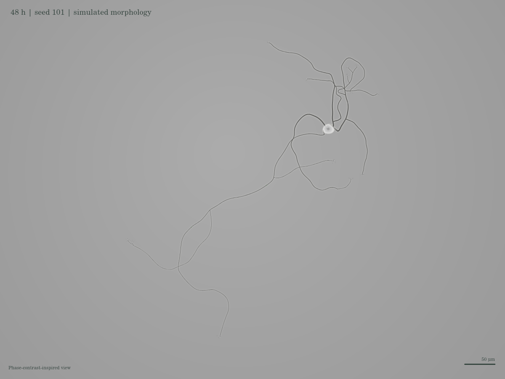
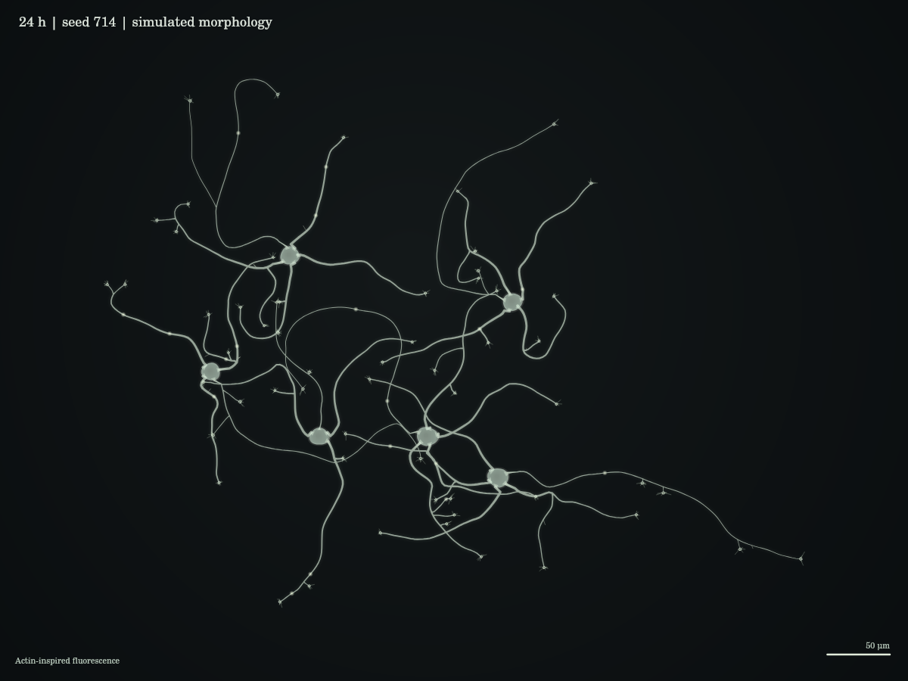

# V3 microscopy and morphogenesis research register

Model: `cell-growth/3.0.0`. Research and implementation reviewed 26 October 2026.

The target of this revision is a developing neuron on a culture substrate: a
settled soma connected to fine, unequal processes, with most fast shape changes
at growing ends and transient lateral protrusions. This is a qualitative
mechanistic model. It is **not an empirical fit, a synthetic microscope image
validated against a dataset, or a prediction for a particular human cell line**.
The clocks in the interface are model hours, not an asserted mapping to DIV.

## What was examined

Three supplied recordings were inspected as temporal frame sequences and at
individual growth-cone and soma close-ups. They show much more localized motion
than the previous display: thin shafts persist while leading margins and
filopodia change independently. Their acquisition intervals, specimen identities
and original sources were unavailable, so no physical rate was estimated from
those recordings. The recordings are not redistributed in this repository.

The primary-source material below was read alongside its figures and, where
specified, sampled video frame sequences. Source footage is reference evidence;
it must never be presented as output of this simulation.

| Source and material examined | Relevant observation | How it is used here |
| --- | --- | --- |
| [Winans, Collins & Meyer, eLife 2016](https://elifesciences.org/articles/12387), [figures and videos](https://elifesciences.org/articles/12387/figures): Videos 1, 2, 3, 7 and 9 | Early cultured rat hippocampal neurites show anterograde actin-associated waves and intermittent extension; later growth is less wave dependent. DIV1 wave speeds are reported as 2–3 µm/min. | Saved packets travel through the actual tree at 120–180 µm/h and transiently increase local tip drive. Stage-dependent weights reduce their influence later. A packet selects one daughter at a junction. This does not solve actin–microtubule feedback or molecular transport. |
| [Fuchs & Eickholt, J Cell Sci 2021: Precursor types predict the stability of neuronal branches](https://journals.biologists.com/jcs/article/134/23/jcs258983/273627/Precursor-types-predict-the-stability-of-neuronal), Movie 1 | Mouse hippocampal time-lapse cultures show substantial protrusion/branch turnover and precursor-dependent retention. | Visible shaft buds may withdraw or consolidate into retained branches. The numerical probabilities and lifetimes are declared model choices, not recovered study estimates. |
| [Marchenko et al., Mol Biol Cell 2017](https://pubmed.ncbi.nlm.nih.gov/28228546/), abstract and figure captions | Dendritic filopodia have heterogeneous extension/retraction dynamics associated with actomyosin and adhesion. | Independent saved renewal processes replace synchronized sinusoidal spokes. Growth-cone filopodia are not equated quantitatively to dendritic filopodia, and the paper's PDE model is not reproduced. |
| [Szebenyi et al., J Neurosci 1998](https://pubmed.ncbi.nlm.nih.gov/9742160/), abstract and figure captions | Long-term cortical-neuron imaging relates delayed shaft branching to earlier growth-cone pausing and residual filopodial or lamellar activity. | This supports inspecting branch precursors and their history, not only a final arbor. V3 has visible precursors and retention, but does not implement a spatial memory of prior growth-cone pauses or the study's target-recognition hypothesis. |
| [Lin et al., Nature 2026](https://www.nature.com/articles/s41586-026-10755-6), main text and Figure 1 | The authors report soma-initiated actin dynamics, coordinated pre-polarization extension/retraction, and later persistent axonal growth. | This establishes an explicit limit: V3 uses reduced local wave clocks and developmental selection, and does **not** implement the reported soma-wide ARP2/3/actomyosin oscillator or global inhibitory competition. |

For the eLife videos, the source captions identify the acquisition intervals and
scale bars: Video 2 uses 5-minute acquisition intervals and a 30 µm bar; Video 3
uses 5-minute intervals and a 40 µm bar; Video 7 uses 1-minute intervals and an
8 µm bar; Video 9 uses 5-minute intervals and a 50 µm bar. These are distinct from
movie playback speed. Their visible remodeling was used qualitatively; no
pixel-derived growth-rate fit or numerical image-similarity score is claimed.

The existing mechanics references remain in [MODEL.md](MODEL.md) and the public
[methods page](../../src/pages/simulations/cell-growth/methods.astro). Different
preparations support different regimes; results from adhesive 2D culture cannot
establish the same mechanism in an adhesion-inert 3D matrix.

## Simulation systems considered

The following systems were reviewed through their primary documentation and
papers. They were not installed, benchmarked, or used to generate the V3 results.

| System and reviewed source | Relevant level of description | Integration assessment for this revision |
| --- | --- | --- |
| [NeuroDevSim growth documentation](https://cns-oist.github.io/NeuroDevSim/growth.html) and [De Schutter 2023](https://www.frontiersin.org/journals/neuroinformatics/articles/10.3389/fninf.2023.1212384/full) | Phenomenological growth fronts, terminal/interstitial branching, pruning, collision-limited migration and environmental interactions | A useful comparison for tree topology and population growth. Its growth rules still need preparation-specific choices; using the framework alone would not establish microscopy fidelity. V3 retains the existing browser worker and its coupled membrane/material solver. |
| [Cytosim overview](https://cytosim.org/) and [EMBL training overview](https://www.embl.org/training/self-paced-learning/simulating-cytoskeleton-cytosim/) | Flexible cytoskeletal filaments, molecular motors and network mechanics at intracellular scales | Relevant to a future explicitly resolved growth-cone model. V3's coarse actin/MT fields and packets are not a Cytosim calculation, and decorative filament lines must not imply that resolution. A coupled filament model would require its own parameters, interface and numerical/experimental checks. |

These are architectural assessments, not comparative performance measurements.
No external framework's biological validation is transferred to this model.

## Changes driven by the observations

| Previous issue | Implemented change | Boundary of the implementation |
| --- | --- | --- |
| A repeated, tidy radial cell with uniform tubes | Four to six unequal primary processes, angular persistence/noise, separate axon/dendrite development, continuous surface taper and unequal branch orders | Physical shafts remain finite-radius capsules. Display taper stays inside those envelopes; it does not silently alter their material ledger. |
| A round, opaque tip with coordinated spokes | Twelve locally evolving lamellar sectors and nine independently renewing filopodia; a thinner peripheral sheet and denser central region in phase-inspired contrast | The rim is a coarse shape model. It is not a resolved membrane/cytoskeletal mesh of the entire cone. |
| Growth that appears continuously drawn outward | Local growth episodes and finite-speed actin-associated packets, pauses and withdrawal, stage-dependent persistence | Packet arrival changes local growth drive; it is not voltage, an action potential, or a measured actin concentration. |
| Branches that simply appear and remain | Shaft protrusion, withdrawal, consolidation and early branch pruning, with different retention assumptions for the two precursor classes | Bud and probe surfaces are not included in the retained-shaft membrane ledger. Their rates are exploratory. |
| Rigid distal bends or artificial whole-arbor waving | Small overdamped relaxation of eligible young distal joints; older shafts and branch junctions remain anchored | This is a local regularization with a speed limit, collision guard and surface-budget accounting, not a complete viscoelastic neurite model. |
| Decorative motion disconnected from simulation | All moving boundaries and protrusions derive from saved state; display interpolation runs only between completed states | Interpolated frames are for viewing. Metrics, exports and paused geometry use the solver state. |
| A bead-obstacle arena as the ordinary culture | An unpatterned plate is the default, with zero imposed guidance; an obstacle assay is selectable | Other environments retain their explicit solids and guidance settings. |
| Colors and end-cap seams dominating the specimen | Seam-free compound shaft fills, actual soma silhouette, phase-inspired and actin-inspired fluorescence views, physical scale bars | Contrast, halos and static intracellular granularity are illustrative. There is no calibrated optical point-spread function or simulated organelle traffic. |

## Declared choices, not measurements

The packet speed range is tied to the cited early-culture report. The following
are model choices: root-source event rate (1.4/h before stage scaling), packet
amplitude and decay (0.42 h), filopodium maximum length (7 µm), extension limit
(26 µm/h), sector response time (0.075 h), shaft relaxation rate (0.22/h), and
maximum joint displacement rate (0.6 µm/h). They are not universal neuronal
constants. Source clocks are independent per root, so 1.4/h is not a claimed
whole-cell event rate. Full equations and branch-retention choices are in
[MODEL.md](MODEL.md#local-growth-traveling-packets-and-exploratory-contacts-30).

The culture and 3D environments share a reduced growth engine. Neuron type,
substrate chemistry, DIV, glial support, imaging modality and experimental
perturbations would need to be fixed before fitting this model quantitatively.
Soma displacement remains mechanically calculated; realistic whole-cell
migration would require further validation of neurite tension, traction and
adhesion against a specified preparation.

## Inspecting the result

The observation buttons compute an experiment from time zero, then pause at
12 hours (early single neuron), 48 hours (branched neuron), or 24 hours (six-cell
culture). The initial view is the 48-hour branched neuron. These are generated
states, not hand-authored meshes. Use **Tip** and
**Tip study · detailed motion** to inspect local exploration. The microscopy
Tip camera follows the selected cone; shift-drag restores manual framing; use **Cell** to inspect
the complete arbor. Normal playback groups two 3-minute solver steps and is useful for broad growth;
Tip study makes the individual computed changes easier to inspect. **Mechanics** exposes the physical contact
envelopes, and **Reset to 0 h** exposes the developmental history.

Slow viewing preserves the configured integration step. At the default 0.05 h
step, Tip study displays each completed 3-minute step over approximately 1.4 s;
Slow uses approximately 280 ms. Normal and Fast group multiple whole solver
steps. Display interpolation respects reduced-motion preference, never
extrapolates beyond the next completed state, and never feeds screen-space motion
into the solver. Pausing reveals the completed state.

The default three-minute state interval and the chosen protrusion clocks are a
coarse representation. Sub-minute membrane ruffling and molecular fluctuations
are not resolved, and smooth playback does not recover those missing dynamics.

## What must still be established experimentally

Visual resemblance does not validate dynamics. A future calibration should use
annotated, time-stamped cultures of one declared cell type and a held-out cohort.
At minimum, compare extension/retraction distributions, branch birth and survival,
cone-area fluctuations, filopodial length/lifetime, soma displacement, shaft
curvature, polarity timing and separate axon/dendrite Sholl profiles. Evaluate
these jointly: fitting a final arbor alone can conceal unrealistic trajectories.

This release adds numerical verification of the new behavior and a multi-seed
geometry study. The exact source hashes and outcomes are in the JSON reports;
they establish numerical properties of this implementation, not biological
agreement. See [VALIDATION.md](VALIDATION.md) for reproduction and criteria.

## Rendered observations

These images use the same production microscopy renderer as the laboratory.
They show the declared observation seeds, not microscopy data.

Both begin with immature cells, motility gain 0.25 and branching gain 1.3. The
single-cell observation uses the default density; the six-cell observation uses
density 1.3. All other settings use the V3 defaults. Images are 1200 × 900 at 1×
shaft radius with an orthographic x–z projection and automatic framing. The
caption and scale bar are part of the renderer output. They can be reconstructed
from the named observation buttons and the corresponding visualization modes.

[Watch the computed growth-cone sequence](../../public/media/cell-growth/v3-tip-motion.mp4)
([reproduction metadata](images/v3-tip-motion.json)). The same dendritic tip is
shown in both contrast modes from 12 to 14 model hours. The 16.7-second clip uses
a fixed camera, 0.05-hour solver steps, and ten interpolated display frames per
step at 24 fps. It is accelerated model output, not recorded biological data.
