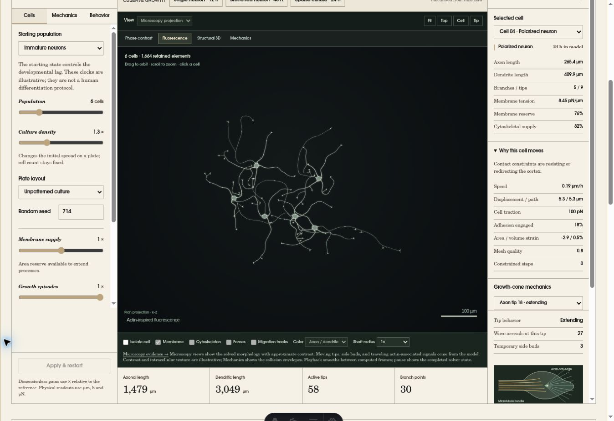

# Cell Growth Laboratory V3: release verification

V3 makes developing cultured neurons the visual reference for the laboratory.
Unequal tapered arbors, local growth-cone exploration, transient shaft buds,
traveling actin-associated packets, and slow relaxation of young distal shafts
are computed from saved state. The phase-inspired and fluorescence views use
that geometry. Contrast remains illustrative; this release is not an empirical
fit to a specified neuronal preparation.

The [research register](V3_RESEARCH.md) records the supplied recordings and
primary-source video sequences examined, the observations used, and the
parameters that remain chosen assumptions. [MODEL.md](MODEL.md) states the
equations; [VALIDATION.md](VALIDATION.md) states the numerical criteria.

## Numerical evidence

The source-hashed reports are the authoritative numerical record:

- [Neurite and whole-population gates](../../src/data/cell-growth-validation.json)
- [Membrane and cell-mechanics gates](../../src/data/cell-growth-mechanics-validation.json)
- [Sixteen-seed, four-environment study](../../src/data/cell-growth-cohort-validation.json)

The cohort requests 72 model hours for each of 64 independently seeded runs,
with full-tree audits every 12 hours. It checks connectivity, obstacles, foreign
somata and shafts, bounds, taper envelopes, material accounting, and exact JSON
state restoration. The source hashes include the runner. A failed run is
recorded explicitly and stops the study; incomplete or stale reports cannot pass
the build verifier. These are discrete numerical checks, not biological data.

Two failures discovered during this study now have constructed regressions:

1. A retracting terminal could leave an active tip on a branch junction and
   subsequently move that junction away from a surviving daughter. Withdrawal
   now stops and deactivates the terminal at the junction.
2. A moving membrane attachment could keep its vertex inside the world while
   its finite-radius root crossed the outer boundary. The mechanical line search
   now checks the complete root capsule against spherical and rectangular
   worlds. The regression includes an unrooted control that presses into the
   excluded clearance and checks attachment continuity and the membrane ledger.

Both fixes retain the physical collision envelopes. Neither hides a failing
shaft through display taper or changes an audit tolerance to obtain a pass.

The motion checks cover independent filopodial renewal, finite-speed packet
transport through a bent tree, one-daughter packet routing, exact save/resume,
young-shaft relaxation, swept barriers, and immutable display interpolation.
Playback tests compare complete seeded states at all four viewing speeds and
exercise the actual worker. Slow viewing changes display duration, preserving
the configured numerical step and random trajectory.

## Browser and visual review

The integrated laboratory was inspected in the cloud Chrome browser:

- The initial branched neuron is computed from zero to 48 model hours and
  pauses. The 12-hour single-neuron and 24-hour six-cell presets also complete.
- Phase-inspired and fluorescence views show the same geometry and metrics.
- The tip camera follows the selected cone during detailed-motion playback.
  Cell framing includes the complete, unequal arbor; cell isolation works.
- Pause, reset, six-hour advance, parameter application, obstacle selection,
  and JSON import were exercised through the interface.
- Publisher reference footage and the local computed motion example load and
  play. The latter is explicitly labeled as accelerated model output.
- Structural rendering recovers through the software fallback when WebGL is
  unavailable.

Hardware WebGL is disabled in this browser, so its visual path remains
unverified here. Browser download capture reported failure on both the local
HTTP preview and hosted HTTPS preview, while the application acknowledged the
export request and logged no application exception;
JSON/CSV/SWC generation and restoration were checked at the worker and engine
boundaries, but successful delivery to this browser's download directory was
not established. These limits must not be described as completed end-to-end
hardware or download tests.



The [computed motion example](../../public/media/cell-growth/v3-tip-motion.mp4)
uses the production renderer and the same simulated dendritic tip in both
contrast modes. Its [metadata](images/v3-tip-motion.json) gives the seed,
configuration, model interval, solver step, camera and display timing. The
source recordings are not redistributed.

## Compatibility and reproduction

The model version is `cell-growth/3.0.0`. V3 saves include independent local
random streams, packet state, branch precursors and remodeled geometry. V2
documents are rejected with a version error; they are not silently migrated.

```sh
node --test --test-concurrency=2 tests/*.mjs
node scripts/validate-cell-growth.mjs
node scripts/validate-cell-growth-mechanics.mjs
node scripts/validate-cell-growth-cohort.mjs 16
npm run build --ignore-scripts
node scripts/verify-cell-growth-build.mjs
```

The build verifier requires all 64 declared seed/environment combinations,
passing source-current reports, the V3 worker, the methods routes and the
computed MP4 asset. The site's CI separately checks the shared laboratories.

## Release-check results

The final-source full site suite passed **915 tests**, with **three existing
browser-dependent skips** and no failures (918 total). The new moving-root
boundary regression is included. The complete site build and the Biohybrid,
Cortex, cochlear and both Finger Atlas artifact verifiers also passed.

Recomputing all six retained observation snapshots with the boundary fix produced
exactly the same states. Regenerating the computed motion sequence produced
400 byte-identical PNG frames, confirming that the shipped movie still depicts
the final implementation.

The final numerical/cohort and published-preview results are pending completion.
