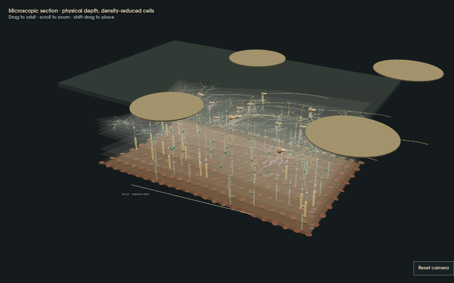

# Retina Laboratory migration

Canonical route: `/simulations/retinal-implant/`. The former PRIMA application redirects to the same laboratory with photovoltaic mode selected. Both methods routes remain accessible.

## Baseline and module inventory

Work started from main commit `ea663c2360b315d5a846e6a0aba5cdf254f82ed7` on `feature/unified-retina-laboratory`. Before changes, `npm test` passed 941 tests with 3 browser checks intentionally gated to CI; the baseline production build passed.

- `src/lib/retinal-implant`: retained finite-contact field, model, pulse scheduling, pinned pulse2percept reference, original experiment API and tests.
- `src/lib/prima`: retained idealized 378-pixel geometry, shared-return circuit, electrode interfaces, half-space fields, stimuli, ProViSim implementation and original experiment API. The only solver extension is an optional read-only current observer for the cable transfer; no numerical equation changed.
- `public/assets/retinal-implant`: original compressed reference chunks, digest, display fibers and upstream license retained.
- `scripts/retinal-reference`, `scripts/prima-reference`, `tests/fixtures`: independent numerical verification and licenses retained.
- `src/lib/retina-lab`: shared schema, coordinates, scene encoding, anatomy, retinal response, optical approximations, worker and renderer.
- `src/components/UnifiedRetinaLaboratory.jsx`: one replacement interface. Original components remain unreferenced source for migration history, not alternate published applications.

## Reproduction

`npm ci`; `npm test`; `npm run build`; `node scripts/verify-retinal-build.mjs`; `node scripts/verify-prima-build.mjs`.

`tests/retina-unified.mjs` adds 23 scientific and migration checks. `RETINAL_REQUIRE_BROWSER=1 node --test tests/retinal-browser.mjs` and `PRIMA_REQUIRE_BROWSER=1 node --test tests/prima-browser.mjs` are graphics-enabled CI checks. Local visual QA uses the managed Sites preview. Its browser has WebGL disabled; the anatomical canvas fallback was inspected there, and full WebGL is checked separately in CI.

## Model status

Read [SCIENCE.md](SCIENCE.md) for equations, units, parameter provenance and the explicit difference between numerical verification, biological validation and perceptual validation. New coupling, procedural anatomy and optical/thermal approximations are research prototypes. There is no claim of human retinal or clinical validation.

The implementation includes all three tiers (a selected cable for Tier 3), both retained appearance baselines, common-input comparisons, disease survival, rigid placement, imported circular arrays, sampled media, synchronized recordings, gap sweeps and reproducible exports. Limitations are listed in the UI and methods: custom photovoltaic geometry, authentic traced neurons, layered/anisotropic conduction, calibrated diffuse optics, continuous video state and patient outcome fitting remain incomplete.

## Rendered verification evidence

### Implant assembly rendering

All backing, contacts, photodiodes and return-grid geometry use one active-face
mapping. PRIMA is a rigid planar display plate tangent to the modeled inner
retinal reference at the placement anchor; the electrical substrate and contacts
share the curved retinal display mapping. Backing extents cover the actual
contacts, including asymmetric imported arrays. Microscopic views clip the same
assembly to the 850 × 500 µm tissue window instead of recentering a replacement
board. Clipped or hidden contacts cannot be selected.

This is display geometry, not an implant–tissue mechanics solution. PRIMA's gap
is anchored at placement; local separation varies against curved undeformed
tissue, and tissue can intersect the rigid plate. No surgical tissue displacement
is modeled. The existing planar conductive fields and numerical references are
unchanged. `tests/retinal-implant-geometry.mjs` verifies attachment, rigid PRIMA
planarity, placement, clipping consistency and imported-array backing bounds.

Actual WebGL output from verification run [40344318997](https://github.com/corbins-cryo-pod/buildthesimulation/actions/runs/40344318997), at migration commit `a00aaf67a8b9c131cdc00cbbde4657a3d4c3bc4c`. The artifact includes desktop/mobile/theme screenshots and exported experiment checks. The displayed geometry is procedural and density-reduced, as described in the methods.
