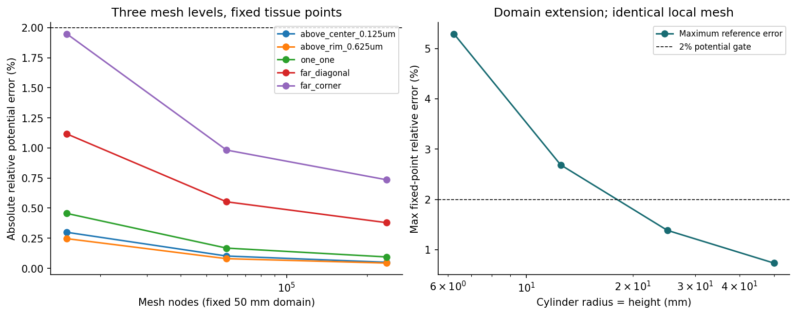
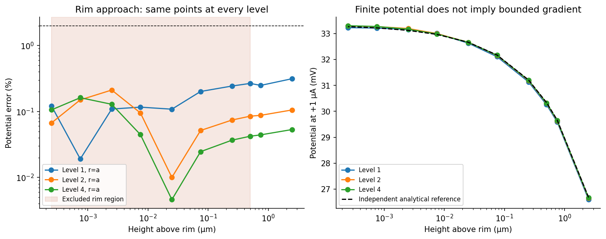
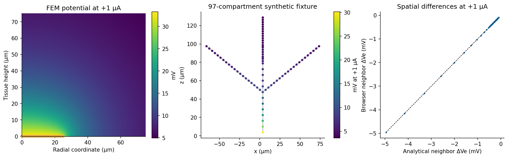

# Validation report — finite-contact-field 1.0.0

**Final release gates: PASS. Readiness: experimental benchmark integration only.**
This package implements one equipotential 25 µm radius disk in an insulating
plane with homogeneous isotropic 0.3 S/m tissue. The numerical return/gauge
is a grounded cylinder of radius/height 50 mm. It approximates the analytical
half-space return at infinity; the two boundary conditions are compared
explicitly through domain convergence. No implanted finite return is modeled.

The finest mesh contains 237,185 nodes and 472,416 P1 triangles.
The accepted tissue region is r≤250 µm, 0<z≤250 µm, excluding a 0.5 µm
neighborhood of the sharp rim. The evidence is finite sampled coverage,
not an error bound for every mathematical point in that region.

## Predeclared acceptance criteria and retained failures

`tolerances.json` was written before the first study and was not changed.
SHA-256: `4f88a77bea324a6ab23c4b8901f6d2174cd8a2ff982cded934f7dd4ff4f4a051`.
Potential reference tolerance: 2%; final mesh/domain changes: 1% each;
weak current balance and algebraic residual: 1e-9; raw integrated gradient
current/leakage: 5%; far-field potential: 2%; current scaling: 1e-10.
Export tolerance is `2e-7*|source| + 0.001 V/A`. Neighbor-difference tolerance
is `0.05*|reference difference| + 1 V/A`. These are preliminary engineering
criteria, not biological firing or safety criteria. Absolute errors are
reported alongside relative errors, and near-zero differences use the mixed
absolute/relative test. There are no failed final release gates.

| Retained failure | Measured | Limit | Context |
|---|---:|---:|---|
| mesh_level_1_raw_return | 16.5791% | 5.0000% | coarse_refinement_diagnostic |
| mesh_level_2_raw_return | 8.1103% | 5.0000% | coarse_refinement_diagnostic |
| domain_last_change | 1.3373% | 1.0000% | superseded_initial_domain1000 |

The initial 1000a domain failed the last domain-change gate. Increasing the
domain to 2000a corrected it without changing tolerances or local mesh nodes.
The complete original report remains in `initial-domain1000-results.json`.
Coarse raw flux failures show why boundary reactions alone are insufficient
to assess local-gradient accuracy.

## Independent reference and convergence

The FEM solves a mixed-boundary variational problem without calling the
analytical function. `validation/reference.py` independently evaluates the
focal-distance arcsin solution for the same equipotential disk and insulating
plane, with return at infinity. The analytical contact resistance is
1/(4σa)=33333.3333 Ω; the finite-domain numerical value is
33316.776216 Ω. Uniform current density was not imposed.

At 2,002 held-out tissue positions (including 13 fixed points,
near-contact points and independently seeded off-grid samples), maximum
potential error is **0.7352%**,
maximum absolute error **16.859211 V/A**,
and RMS absolute error **12.877775 V/A**.
At 1 µA the maximum absolute error is
0.016859 mV.

All fixed evaluation points remain physically identical across refinements.
The 30 rim-approach points are also sampled at every mesh level and retained
in `rim_approach` in the machine-readable report.

| Mesh level | Nodes | Triangles | Max fixed-point reference error | Raw return-current error |
|---|---:|---:|---:|---:|
| 1 | 15,008 | 29,526 | 2.0505% | 16.5791% |
| 2 | 59,541 | 118,104 | 0.9825% | 8.1103% |
| 4 | 237,185 | 472,416 | 0.7352% | 4.0115% |

Final mesh change: **0.3071%**.

| Cylinder radius and height | Max fixed-point reference error |
|---|---:|
| 250a / 6.25 mm | 5.2903% |
| 500a / 12.5 mm | 2.6874% |
| 1000a / 25 mm | 1.3860% |
| 2000a / 50 mm | 0.7352% |

Final domain change: **0.6600%**.
The r,z nodes in the local region ≤10a are exactly identical across domain
sizes; local refinement is therefore separated from outer-boundary movement.
Residual domain error includes the potential offset between finite ground
and infinity. No fitted constant was subtracted to improve reference errors.

## Current, signs and far field

| Final integrated quantity | Measurement |
|---|---:|
| Weak injecting current | 1 A |
| Weak return current | 1.00000000000001 A |
| Relative weak imbalance | 1.31006e-14 |
| Relative linear-system L2 residual | 2.62168e-12 |
| Raw-gradient injecting current | 1.002552200 A |
| Raw-gradient return current | 1.040114620 A |
| Raw source/return imbalance | 3.7562% |
| Raw insulating-plane absolute leakage / 1 A | 0.6348% |
| Raw all-boundary signed outward residual / 1 A | 3.1214% |

Weak conormal flux is obtained from integrated FEM boundary reactions. It
is conservative by the discrete variational equations and is not an
independent estimate of pointwise gradient accuracy. Raw flux separately
integrates adjacent P1 gradients over boundary edges with the axisymmetric
surface measure. Those gradients are not equilibrated; the return error is
4.0115%, and no E or J sampler is exported.

A separate shared-contact-unknown current-loaded system tests +1, +0.25,
−0.5 and 0 A at level 2, domain 2000a.
Its largest difference from the normalized basis is
1.72616e-14 relative to peak.
It checks boundary normalization, polarity and linearity using the same
spatial FEM operator; it is not a second independent spatial solver.
Only one spatial basis exists. Multi-contact combined solves are unimplemented.

Far-field measurements at distances roughly 8–10a compare to
`I/(2πσρ)`, the insulating-half-space surface-source expression. Maximum
numerical discrepancy is **0.9520%**.
`I/(4πσρ)` applies to an infinite medium and is not used here. These points
are far from the contact but much closer than the outer return. The finite
grounded cylinder is not globally a monopole field; an explicit finite
source/return pair would instead have different, generally dipolar far-field
behavior and requires a new model.

## Rim and interpolation

The ideal sharp rim has singular current density, although potential is
finite. At the finest level, the approach sweep's maximum potential error is
0.2583%; the nonmonotonic
near-rim errors and refinement results are plotted. The diagnostic sweep
reaches 0.00001a above the rim, outside the accepted region. Passing a finite
set of extreme points does not remove the 0.02a numerical rim exclusion or
establish bounded gradients. No universal safe electrode distance is inferred.

The browser samples the **same native P1 triangles** as the source solution.
Thus spatial discretization/interpolation error is already included in the
FEM-versus-analytical results; export adds Float32 nodal rounding and
JavaScript arithmetic rather than a separate coarse interpolation atlas.
At the independent held-out points, Node export error is at most
**0.001824215 V/A** or
**5.47592e-08 relative**.
Actual Chromium main-thread and Worker checks pass the same locked test.
Serialization, checksums, malformed metadata, units, batched queries,
coordinate rotation, signs, nonfinite inputs, contact/insulation surfaces,
domain exits, coverage exits, rim exclusion, and zero-current invalid-point
propagation are covered by the tests. Unknown or failed sampling never
silently clamps, switches to a point source, or returns zero.

## Neuron fixture and waveform

The synthetic branching fixture has 97 coordinates and 96 parent-child
edges. The report records every absolute potential and neighbor difference,
both numerical and analytical. Maximum exported neighbor-difference error
is **1.616347 V/A**
(0.001616 mV at 1 µA).
All edges pass the predeclared 5% plus 1 V/A criterion.
`examples/waveform.mjs` and the browser Worker example cache unit potentials
once and apply equal-duration ±2 µA biphasic phases, reporting mV with
explicit ms/µA conversions. This tests the field/cable interface, not neural
firing, stimulation threshold, membrane-radius collision or selectivity.

## Performance and portability

Hardware reported by the execution environment: **AMD EPYC 9V74 80-Core Processor**;
5 visible logical CPUs. Numerical runs use one
BLAS/OpenMP thread. OS: Linux-6.18.55-x86_64-with-glibc2.41.
Python/NumPy/SciPy: 3.12.14 / 2.3.5 / 1.17.0.
The final mesh generation/assembly/solve/diagnostic stage took
**3.210 s**, with **670.969 MiB peak process RSS**.
The eight retained numerical cases total
12.007 s of measured solver
time. Checkpoint reuse in a later report run is not counted as a new solve.
Peak memory is measured per solver subprocess, not inferred from array sizes.

Binary field: **956,564 bytes**; JSON manifest:
**4,085 bytes**; required browser download total:
**960,649 bytes**. Diagnostics are optional for runtime.
Retained field typed arrays consume **956,564 bytes**.
Loading temporarily retains the caller input plus a verified owned copy;
release the original buffer when appropriate. A 100,000-point query uses
2,400,000 input bytes plus 900,000 output bytes. A cached basis requires
900,000 bytes for 100,000 points; each waveform output is a separate array.

| Runtime | Load ms | 1,000 points ms | 10,000 points ms | 100,000 points ms | 100,000 throughput |
|---|---:|---:|---:|---:|---:|
| Node 24.19.0 | 16.01 | 0.237 | 1.139 | 9.048 | 11.05 million/s |
| Chromium main thread | 16.70 | 0.200 | 2.200 | 9.800 | 10.20 million/s |
| Chromium Web Worker | 5.30 | 0.400 | 1.900 | 10.700 | 9.35 million/s |

Throughput is the median of seven warmed runs, three warmups, including
query classification and output allocations. Inputs cycle through the
held-out fixture; this is a local CPU microbenchmark, not a whole neuron
simulator benchmark. Browser clock granularity affects small batches.
Load timings include validation and SHA-256, but exclude network fetch;
local fetch times are recorded separately. Node process RSS and Chromium
main-thread JS heap before/after are retained in JSON and are noisy. Worker
heap instrumentation was unavailable; exact typed-array memory is reported
instead, without claiming a measured worker process peak.

Actually tested: Node v24.19.0, Chromium 154.0.8037.57
main thread, Chromium module Web Worker, and the interactive example.
No Firefox, Safari, mobile, production website or repository integration
was tested. No second numerical spatial solver was added.

## Figures and evidence

Vector PDF versions are included. `results.json` consolidates all measurements,
gates and failed gates; the separate environment reports preserve raw values.
See `INTEGRATION_HANDOFF.md` for the remaining neural convergence, collision,
threshold, interface and implant-geometry work. A verified field component
alone does not establish accurate single-neuron selectivity.
